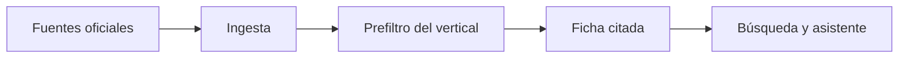

# Blue Tender

Buscador de financiación para la transición energética marina.
Subvenciones, licitaciones públicas y quién lo ha hecho antes. Cada cifra apunta al texto oficial.

Un agregador horizontal parte *vessel* en dos: el barco y el recipiente. Aquí el sector es un archivo de configuración, no una lista de palabras sueltas, y el motor es el mismo para el siguiente vertical.

Está pensado para fundaciones, empresas y centros que preparan proyectos de eólica marina, energía oceánica, hidrógeno y solar flotante, puertos verdes, descarbonización de flotas y cables submarinos.

No escribe la propuesta. No cobra. No dice que eres elegible.

## Qué se puede hacer

**Encontrar.** Una búsqueda sobre convocatorias europeas y nacionales, con filtros que no esconden una ficha solo porque le falta un campo.

**Comprobar.** Plazo, presupuesto y cofinanciación arriba de la ficha. Si el dato no está en la fuente, el campo se queda vacío. Si está, se cita de dónde salió.

**Ver quién lo ha hecho antes.** Organizaciones con proyectos de CORDIS o adjudicaciones de TED cercanas a la convocatoria. Es un historial, no una bandeja de mensajes.

**Preguntar.** Un asistente lee los documentos de la convocatoria que tiene delante y, fuera de una ficha, busca en el índice. Responde con el enlace oficial. Si el texto no lo dice, lo dice.

**Avisar.** Guardados, recordatorio de plazo y aviso si el plazo cambia.

## Cómo no se inventa un plazo

El orden de verdad es fijo: campo estructurado de una API, HTML oficial con selector, regla de programa, extracción con modelo, vacío.

Una frase como «un mes desde la publicación» no se convierte en fecha. El modelo no pisa un plazo que ya vino estructurado. Lo que choca entre dos fuentes no se publica: va a revisión. El detalle está en [docs/data-quality.md](docs/data-quality.md).

## De dónde salen las convocatorias

El inventario, con licencia, volumen medido y huecos, está en [docs/sources.md](docs/sources.md). El cron lee, entre otras:

| Ámbito | Fuentes |
|---|---|
| Europa | TED, EU Funding & Tenders, CINEA, Interreg, CETPartnership, EUDP, Mercator Ocean, UKRI |
| España | Plataforma de Contratación del Sector Público, BDNS, sumario del BOE |
| Francia | BOAMP, Aides-territoires |
| Otros | TenderNed, Doffin, Find a Tender |
| Historial, no convocatorias abiertas | CORDIS, adjudicaciones de TED |

Una página oficial sin API se vigila con un selector. Si el texto cambia, se publica la URL, el día en que se vio y la cita. Sin plazo inventado.

Los préstamos, el capital y la filantropía sin fecha viven en un directorio de financiadores. No se mezclan con las convocatorias.

## Un vertical es un YAML

La taxonomía, las keywords, los CPV y las reglas de cofinanciación no están en Python. El primer vertical es [config/verticals/blue-economy.yaml](config/verticals/blue-economy.yaml). Añadir otro es un archivo nuevo, no una rama del pipeline.



Un adaptador que falla se anota y sigue. No tumba la ingesta.

## Arrancar

Hace falta Python 3.11 o superior, [uv](https://docs.astral.sh/uv/) y Node.

```bash
cd backend && uv sync && uv run uvicorn app.main:app --reload
cd frontend && npm run dev
```

Sin `SUPABASE_URL`, la API lee y escribe `backend/data/opportunities.json`. La interfaz queda en [http://127.0.0.1:3000](http://127.0.0.1:3000) y la API en el puerto 8000.

Tests y lint del backend:

```bash
cd backend && uv run pytest && uv run ruff check app tests
```

## Mapa

| Carpeta | Qué es |
|---|---|
| [frontend/](frontend/) | Next.js 15, App Router, Tailwind. La interfaz está en inglés. |
| [backend/](backend/) | FastAPI y uv. Ingesta, búsqueda, ficha, asistente. |
| [config/](config/) | Verticales, programas, financiadores, conocimiento, convocatorias curadas. |
| [docs/](docs/) | Esquema, fuentes, calidad, producto y decisiones. |

Si un cambio toca `config/`, es de vertical o de catálogo. Si toca `backend/` o `frontend/`, es de producto.

## Seguir leyendo

- [Esquema de una oportunidad](docs/opportunity-schema.md)
- [Fuentes](docs/sources.md)
- [Calidad de los datos](docs/data-quality.md)
- [Asistente](docs/assistant.md)
- [Decisiones](docs/decisions/)
- [Cómo está montado el código](CLAUDE.md), pensado para quien vaya a cambiarlo
